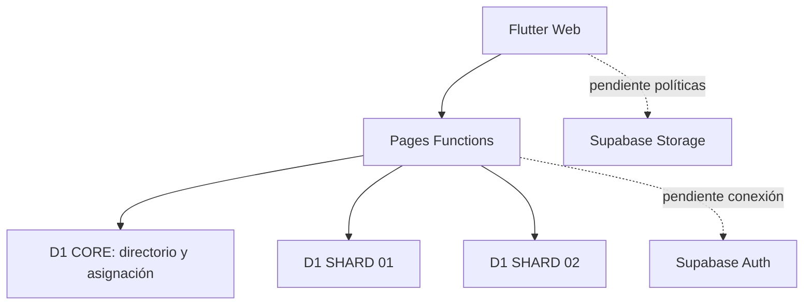

# MenRut · Arquitectura implementada

Estado: entrega inicial parcial — 6 de noviembre de 2026.

Flutter Web → Pages Functions TypeScript → D1 CORE y dos shards. Auth se ha programado con Supabase JWKS, pero no se ha conectado a un proyecto activo. No hay datos operativos en PostgreSQL ni R2.

Código: `app/lib`, `src/core`, `src/modules`, `functions/api/v1`, `database`, `tests`, `scripts`. Android solo tiene estructura generada, no compilación validada.
