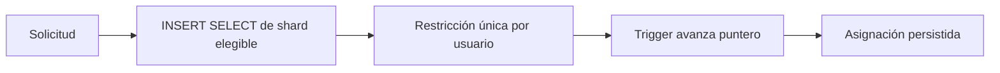

# MenRut · Sharding

> Documento histórico de una entrega anterior. Para el frontend y conexión actuales, consultar [actualización React/Supabase](22-MIGRACION-REACT-Y-CONEXION.md).

Estado: entrega inicial parcial — 6 de noviembre de 2026.

Asignación permanente por UUID en `courier_shard_map`. Un INSERT SELECT ordena shards según el puntero persistente. Un trigger avanza el puntero en la misma transacción SQLite. Restricción PRIMARY KEY impide asignaciones duplicadas. No se acepta shard_id desde Flutter.

Métricas reales se actualizan con `python scripts/measure_shards.py`. La asignación se bloquea si la medida tiene más de 24 horas, el shard está deshabilitado o alcanza 95 %. Ese TTL conservador requiere operación administrativa periódica, no cron obligatorio. Aún falta el bloqueo de escrituras no esenciales al 100 %.

Para añadir 03–09: crear D1, añadir binding D1_SHARD_XX en Wrangler, aplicar migraciones de shard, medir tamaño e insertar registro habilitado. No existen todavía esos recursos. No hay migración automática.

