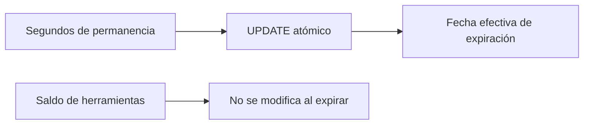

# MenRut · Créditos

> Documento histórico de una entrega anterior. Para el frontend y conexión actuales, consultar [actualización React/Supabase](22-MIGRACION-REACT-Y-CONEXION.md).

Estado: entrega inicial parcial — 6 de noviembre de 2026.

Permanencia usa enteros en segundos de crédito: 1 crédito = 8640 segundos; 10 créditos = 86400 segundos. `saldo_nuevo=max(0,saldo_anterior-max(0,ahora-settled_at))`. `settled_at=max(settled_at,ahora)`. Presentación = segundos/8640, sin redondear saldo persistido.

Un UPDATE atómico evita descontar dos veces el mismo intervalo. Se conservan segundos parciales. expires_at limita visibilidad sin cron. Herramientas es una columna independiente CHECK >=0; no cambia al liquidar permanencia.

Pendiente: ledger por cada liquidación temporal, reservas y ejecución de herramientas, devoluciones, límites de uso, renovación acumulativa y concurrencia de renovaciones. No usar aún para operaciones comerciales reales.

