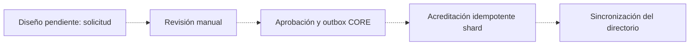

# MenRut · Pagos

Estado: entrega inicial parcial — 6 de noviembre de 2026.

Solo existen esquema y planes borrador. No existe flujo de compra ni aprobación. Los precios no aparecen en el endpoint público porque active=0. Los valores de plan son propuestas sin activación administrativa.

Pendiente implementar snapshot del plan, comprobantes privados, revisión manual con permisos, aprobación idempotente y evento CORE→shard recuperable. Subir una imagen nunca debe aprobar un pago.

