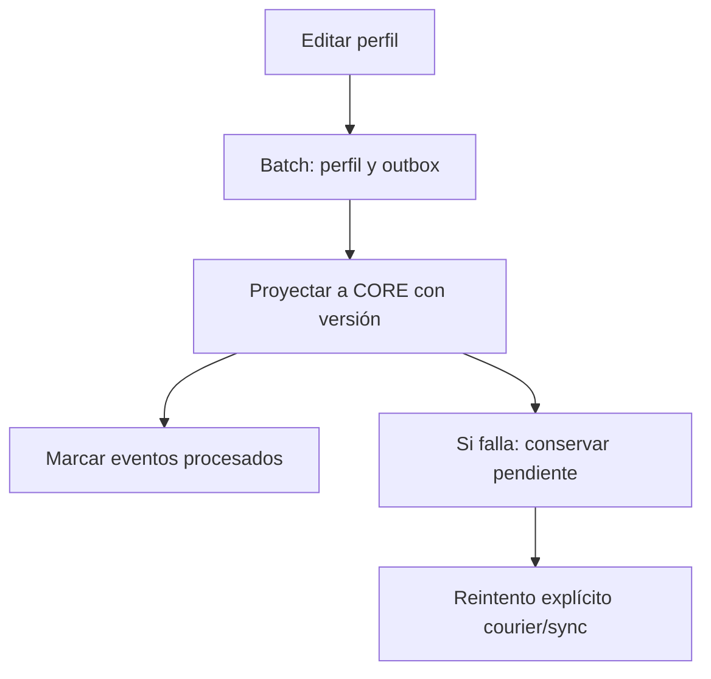

# MenRut · Outbox

> Documento histórico de una entrega anterior. Para el frontend y conexión actuales, consultar [actualización React/Supabase](22-MIGRACION-REACT-Y-CONEXION.md).

Estado: entrega inicial parcial — 6 de noviembre de 2026.

Edición de perfil y evento se guardan en un batch del shard. La proyección CORE usa UPSERT protegido por versión creciente. Si CORE falla, el evento permanece sin procesar. POST /courier/sync reproyecta el estado actual.

Pendiente: dispatcher general de eventos, backoff, reconciliación administrativa completa, orden de eventos financieros y métricas de fallos. La tabla sync_failures existe, pero aún no la rellena el procesador. No hay transacciones distribuidas.

